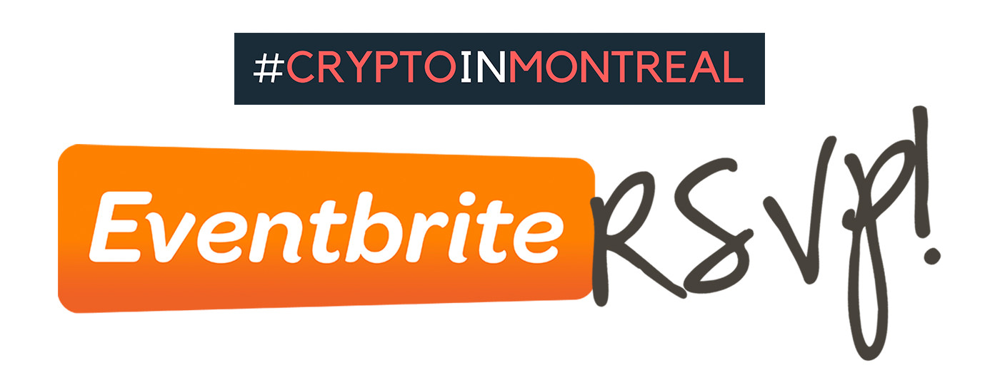

Le 10e événement de #CryptoInMontreal aura lieu ce **mardi 17 avril 2018** dès 18h15 à l'Anticafé Local sur la rue Crescent dans le Centre-Ville de Montréal. Le calendrier pour l'année 2018 est [disponible ici](/tags/crypto-in-montreal/).

**Introduction** — Pour ceux et celles qui désirent s'initier aux cryptomonnaies et au blockchain, **l'introduction au monde des cryptos** sera donnée par Pascal Andy. La présentation permettra d'introduire de façon très pratique ceux qui cherchent à faire leur premier pas dans le monde des cryptomonnaies.

**Le teaser de l'événement ci-bas** (ou sur [YouTube](https://www.youtube.com/watch?v=2_rPjzXXfBA))

<iframe width="560" height="315" src="https://www.youtube.com/embed/2_rPjzXXfBA" frameborder="0" allow="autoplay; encrypted-media" allowfullscreen></iframe>

Do you speak **English**? You're welcome as well! I just don't have the time to maintain everything in English at this point.

> Faire un RSVP, c'est s'engager à être présent à l'événement

- **Prix**: 6.50$ payable sur place
- **Date** et **heure**: jeudi 17 avril 2018 à 18h15 (fin à 21h00)
- **Lieu**: [Anticafé Local Crescent](/blog/les-endroits-qui-acceillent-cryptoinmontreal/#club-insiders)
- **Adresse**: 2067 Crescent St #205, Montreal QC H3G 2C1 Montréal Quéebec Canada

Le **prix inclut** — les cafés gourmands de torréfaction locale, les thés et tisanes, les pains haut gamme, les biscuits, le caramel, les légumes et fruits sec, nous avons même des produits sans gluten et véganes. Pour plus de détails --> [Anticafé Local Crescent](/blog/les-endroits-qui-acceillent-cryptoinmontreal/#club-insiders)

Tous les détails de l'événement:
[Lien permanent](/blog/cim-10/)

Cheers! [Pascal Andy](/maintenant/)

## Est-ce pour moi ?

L'événement #CryptoInMontreal s’adresse à toi si tu veux:

1. Commencer à investir dans les cryptomonnaies
2. Discuter avec des gens qui s’intéressent au blockchain et la crypto
3. Agrandir ton cercle d’amis et de connaissances

En d’autres mots, **#CryptoInMontreal** à trois buts principaux:

- Le **premier** objectif est de **démocratiser les cryptomonnaies** (cryptocurrency). Nous voulons aider les gens qui désirent commencer à investir dans les cryptomonnaies à faire leurs premiers pas.
- Le **deuxième** objectif est de **réunir les initiés** qui s'intéressent déjà au sujet des cryptomonnaies. Nous pourrons échanger et découvrir les différents enjeux de l’écosystème du blockchain et des cryptomonnaies altcoins.
- Le **troisième** objectif de #CryptoInMontreal est de **favoriser les triades**, c’est-à-dire créer un environnement propice à la création de nouvelles connexions entre des gens qui ne se connaissent pas. Ce concept m'a été inspiré de David Logan lors de son [TED talk](https://www.youtube.com/watch?v=xTkKSJSqU-I). Ceci est beaucoup plus puissant que de simplement réunir des gens dans une même salle.

## Agenda et déroulement de la soirée

<iframe width="560" height="315" src="https://www.youtube.com/embed/W_FN9-B60ao" frameborder="0" gesture="media" allow="encrypted-media" allowfullscreen></iframe>

[Lien direct vers YouTube](https://youtu.be/W_FN9-B60ao)

#### En gros

- 18H15 — Arrivé
- 18H30 — On partage et on apprend
- 21H00 — Fin

#### En détail

- **18h30** — Je ferai un tour de table pour connaître le niveau de maturité des invités afin de mieux diriger la soiré.
- **18h40** — Je ferai une introduction de 15 min afin que les invités puissent faire leurs premiers pas dans le monde des cryptomonnaies.
- **19h10** — Je nommerai les **Capitaines** pour la soirée (voir la vidéo ci-dessous pour plus de contexte).
- Avec l’ensemble des invités sur places, nous déterminerons les 3 grands thèmes à discuter pour la soirée.
- **19h20**, 1er sujet | **19h45**, 2e sujet | **20h10**, 3e sujet
- **Dynamique de groupe** — Chaque sujet est discuté en groupe. Une fois le temps écoulé nous faisons un tour de table avec les Capitaines de chaque équipe.
- **20h35** — Elevator pitch
  - S'ils le désirent, les participants pourront faire un elevator pitch de 90 secondes et répondre aux questions des autres invités.
  - Le but est de faire découvrir un sujet plus pointu de l'univers des cryptos. Exemple: une technologie, un projet, un événement politique, etc.
- **21h00** — Réseautage, rencontre et hasards de la vie. Au final n'est pas pourquoi on prend le temps de se déplacer?

## Informations générales

- [Site officiel](/tags/crypto-in-montreal/) de #CryptoInMontreal
- [Pré-requis](/tags/crypto-in-montreal/)
- [Qui est l'organisateur](/tags/crypto-in-montreal/) de #CryptoInMontreal ?
- [FAQ](/tags/crypto-in-montreal/) (questions et réponses)
- [Le calendrier 2018](/tags/crypto-in-montreal/).

## Contacts

Je suis très (très) actif sur [Twitter](https://twitter.com/askpascalandy) et sur le hashtag [#CryptoInMontreal](https://twitter.com/hashtag/CryptoInMontreal?src=hash)

Il y a plusieurs façon de demeurer au courant des prochains événements:

- [Site web officiel](/tags/crypto-in-montreal/)
- Suivre sur [EventBrite](https://www.eventbrite.ca/o/cryptoinmontreal-15852655206)
- Suivre sur [Meetup.com](https://www.meetup.com/CryptoInMontreal)
- Suivre sur [Facebook](https://www.facebook.com/cryptoinmontreal/)
- Suivre sur [Twitter](https://twitter.com/search?src=typd&q=%23cryptoinmontreal)

## RSVP et présence

Lorsque vous confirmez votre présence, merci de respectez votre engagement.

Il devient très difficile de gérer les gens qui **confirment** leurs présences, mais qui ne se présente pas. Faire un RSVP, c'est s'engager à être présent à l'événement 🙌.

## Billetterie

L'admission est **gratuite**. Deux façons de réserver sa place:

- **Meetup**: https://www.meetup.com/CryptoInMontreal
- **EventBrite**: https://www.eventbrite.ca/o/cryptoinmontreal-15852655206

> Faire un RSVP, c'est s'engager à être présent à l'événement 🙌

Au plaisir de se croiser au prochain événement de #CryptoInMontreal!
