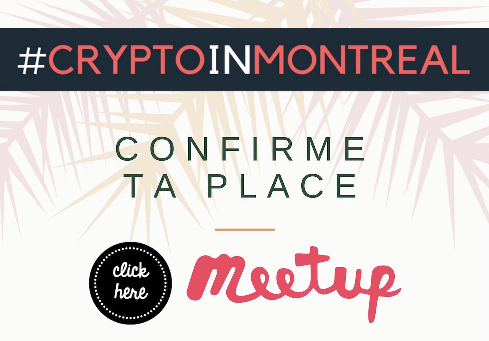

## Agenda de la soirée

1. Durant cet événement, je ferai une **introduction au monde des cryptos**. La présentation permettra d'introduire de façon très pratique ceux qui cherchent à faire leur premier pas dans le monde des cryptomonnaies.
2. Je ferai une démo de la fonction de **hashing SHA-256** qui est au coeur du protocole Bitcoin et du POS.

## Quand et où ?

- **Quand**: Ce mardi 17 juillet 2018 dès 18h30
- **Lieu**: [Club Insiders](/blog/les-endroits-qui-acceillent-cryptoinmontreal/#club-insiders), 2067 Crescent St 2e étage, Montréal QC H3G 2C1 Montréal Quéebec Canada
- **Prix**: 10$ payable sur place

**Tarification de la soirée**: La consommation de cafés bio gourmands de torréfaction locale, les thés et tisanes, les pains hauts gamme, les biscuits, le caramel, les légumes et fruits secs, nous avons même des produits sans gluten et véganes!

- **Détails** de cet événement sur le site officiel : /blog/cim-16/
- **Calendrier 2018**: /blog/calendrier-crypto-in-montreal/
- **Teaser** de l'événement sur [YouTube](https://www.youtube.com/watch?v=2_rPjzXXfBA)

<iframe width="560" height="315" src="https://www.youtube.com/embed/2_rPjzXXfBA" frameborder="0" allow="autoplay; encrypted-media" allowfullscreen></iframe>

## Billetterie

Réservez votre place sur **Meetup** en [cliquant ici](https://www.meetup.com/CryptoInMontreal)

> Faire un RSVP, c'est s'engager à être présent à l'événement 🙌

Au plaisir de se croiser au prochain événement de #CryptoInMontreal!

Cheers!
Pascal

## Est-ce pour moi ?

L'événement #CryptoInMontreal s’adresse à toi si tu veux:

1. Commencer à investir dans les cryptomonnaies
2. Discuter avec des gens qui s’intéressent au blockchain et la crypto
3. Agrandir ton cercle d’amis et de connaissances

En d’autres mots, **#CryptoInMontreal** à trois buts principaux:

- Le **premier** objectif est de **démocratiser les cryptomonnaies** (cryptocurrency). Nous voulons aider les gens qui désirent commencer à investir dans les cryptomonnaies à faire leurs premiers pas.
- Le **deuxième** objectif est de **réunir les initiés** qui s'intéressent déjà au sujet des cryptomonnaies. Nous pourrons échanger et découvrir les différents enjeux de l’écosystème du blockchain et des cryptomonnaies altcoins.
- Le **troisième** objectif de #CryptoInMontreal est de **favoriser les triades**, c’est-à-dire créer un environnement propice à la création de nouvelles connexions entre des gens qui ne se connaissent pas. Ce concept m'a été inspiré de David Logan lors de son [TED talk](https://www.youtube.com/watch?v=xTkKSJSqU-I). Ceci est beaucoup plus puissant que de simplement réunir des gens dans une même salle.

## Contacts

Je suis très actif sur [Twitter](https://twitter.com/askpascalandy) et sur le hashtag [#CryptoInMontreal](https://twitter.com/hashtag/CryptoInMontreal?src=hash)

Il y a plusieurs façons de demeurer au courant des prochains événements:

- [Site web officiel](/tags/crypto-in-montreal/)
- Suivre sur [Meetup.com](https://www.meetup.com/CryptoInMontreal)
- Suivre sur [EventBrite](https://www.eventbrite.ca/o/cryptoinmontreal-15852655206)
- Suivre sur [Facebook](https://www.facebook.com/cryptoinmontreal/)
- Suivre sur [Twitter](https://twitter.com/search?src=typd&q=%23cryptoinmontreal)

## RSVP et présence

Il peut-être difficile de gérer la soirée (et l'espace réservé pour l'événement) à cause des gens qui **confirment** leurs présences mais qui ne se présentent pas. Faire un RSVP, c'est s'engager à être présent à l'événement 🙌. Lorsque vous confirmez votre présence, merci de respecter votre engagement.
