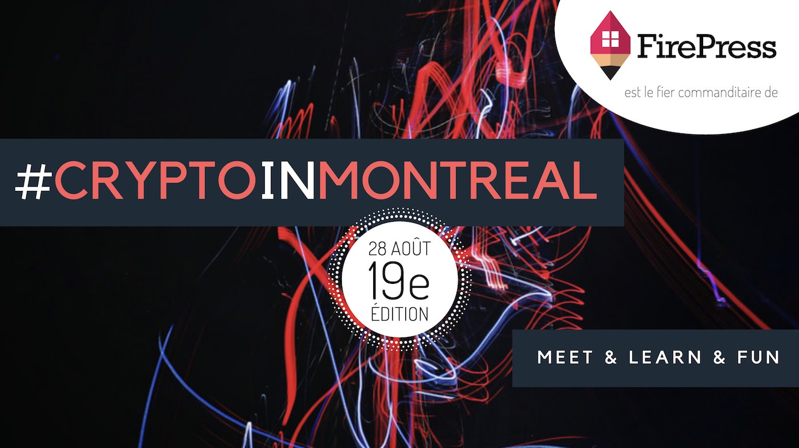
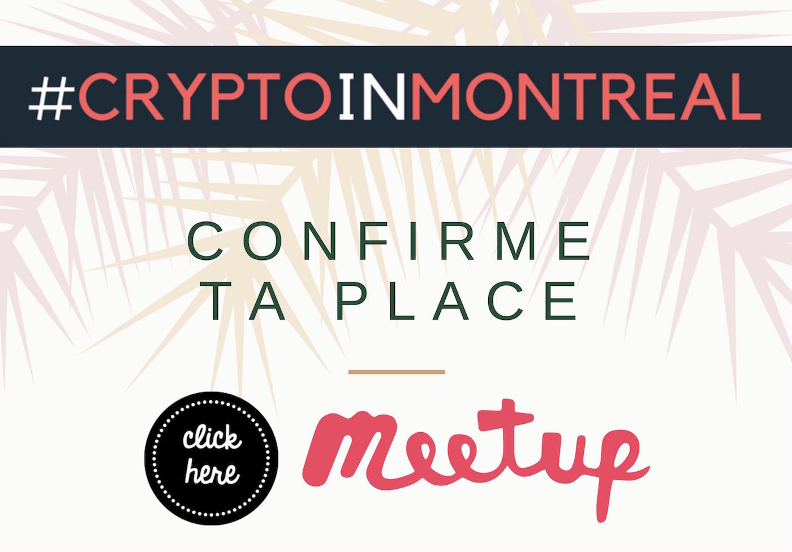

## Agenda de la soirée

Voici le plan de match pour le **19e événement** de [#CryptoInMontreal](/tags/crypto-in-montreal/). **Crédit de 20$** — Tous les gens présents à l'événement obtiendront un crédit de 20$ valable sur un marché d'échange canadien. La carte 'voucher' sera remise en personne.

Nous débuterons avec une présentation animée par **Tamara Kara**. Rejoignez-nous pour apprendre et discuter du sujet de la **CryptoÉconomie**. La présentation sera en Anglais et les discussions pourront se dérouler en Français ou en Anglais.

La cryptoéconomie est concept relativement nouveau pour la plupart d'entre nous et nous essaierons de comprendre quels sont ses enjeux. Bien que des connaissances de base sur le blockchain soient utiles, les participants avec tous les niveau des connaissance seront les bienvenues. Pour ceux qui débutent, ça sera une excellente opportunité de découvrir du monde fascinante de blockchain et des cryptomonnaies.

► THÈMES ►
Voici les grands thèmes de cette présentation:

• Comprendre la différence entre la cryptoéconomie et les cryptomonnaies
• Le rôle de la cryptoéconomie pour le Bitcoin et l'Ethereum pour résoudre les problèmes de sécurité de l’information
• Le rôle du gas dans l'Ethereum
• Les avantages et enjeux du PoS (Proof of Stake) versus le PoW (Proof of Work)

— — — # — — — # — — — # — — —

Ensuite, dans le 2ième bloque de la soirée, **Pascal Andy** prendera le plancher pour échanger sur les **cas d'utilisations** du blockchain. Nous démystifierons les raisons qui feront du blockchain un "game changer". Les impacts sont immenses. Notre société à vécu l’avant et l’après la venue de l’Internet. Nous verrons pourquoi il en sera de même avec les DLT (distributed ledger technologies).

**Détails** de cet événement sur le site officiel : /blog/cim-19/

## Quand et où ?

- **Quand**: Ce mardi 28 août dès 18h40
- **Lieu**: [Club Insiders](/blog/les-endroits-qui-acceillent-cryptoinmontreal/#club-insiders), 2067 Crescent St 2e étage, Montréal QC H3G 2C1 Montréal Quéebec Canada
- **Coût**: 10$ à la porte. **Le prix inclut**: les de cafés bio gourmands de torréfaction locale, les thés et tisanes, les pains hauts gamme, les biscuits, le caramel, les légumes et fruits secs. _Il y a même des produits sans gluten et véganes_ (c'est pas de l'inclusion ça!).

<iframe width="560" height="315" src="https://www.youtube.com/embed/2_rPjzXXfBA" frameborder="0" allow="autoplay; encrypted-media" allowfullscreen></iframe>

## Billetterie

Réservez votre place sur **Meetup** en [cliquant ici](https://www.meetup.com/CryptoInMontreal)

> Faire un RSVP, c'est s'engager à être présent à l'événement 🙌

Au plaisir de se croiser au prochain événement de #CryptoInMontreal!

Cheers!
Pascal

## Est-ce pour moi ?

L'événement #CryptoInMontreal s’adresse à toi si tu veux:

1. Commencer à investir dans les cryptomonnaies
2. Discuter avec des gens qui s’intéressent au blockchain et la crypto
3. Agrandir ton cercle d’amis et de connaissances

En d’autres mots, **#CryptoInMontreal** à trois buts principaux:

- Le **premier** objectif est de **démocratiser les cryptomonnaies** (cryptocurrency). Nous voulons aider les gens qui désirent commencer à investir dans les cryptomonnaies à faire leurs premiers pas.
- Le **deuxième** objectif est de **réunir les initiés** qui s'intéressent déjà au sujet des cryptomonnaies. Nous pourrons échanger et découvrir les différents enjeux de l’écosystème du blockchain et des cryptomonnaies altcoins.
- Le **troisième** objectif de #CryptoInMontreal est de **favoriser les triades**, c’est-à-dire créer un environnement propice à la création de nouvelles connexions entre des gens qui ne se connaissent pas. Ce concept m'a été inspiré de David Logan lors de son [TED talk](https://www.youtube.com/watch?v=xTkKSJSqU-I). Ceci est beaucoup plus puissant que de simplement réunir des gens dans une même salle.

- **Calendrier 2018**: /blog/calendrier-crypto-in-montreal/
- **Teaser** de l'événement sur [YouTube](https://www.youtube.com/watch?v=2_rPjzXXfBA)

## Un petit geste qui nous aide grandement

- Ça devient problématique quand les gens **confirment leurs présences mais ne se présentent pas** :•(
- Faire un **RSVP**, c'est s'engager à être présent à l'événement 🙌. Lorsque vous confirmez votre présence, merci de respecter votre engagement :•)

## Contacts

Je suis très actif sur [Twitter](https://twitter.com/askpascalandy) et sur le hashtag [#CryptoInMontreal](https://twitter.com/hashtag/CryptoInMontreal?src=hash)

Il y a plusieurs façons de demeurer au courant des prochains événements:

- [Site web officiel](/tags/crypto-in-montreal/)
- Suivre sur [Meetup.com](https://www.meetup.com/CryptoInMontreal)
- Suivre sur [EventBrite](https://www.eventbrite.ca/o/cryptoinmontreal-15852655206)
- Suivre sur [Facebook](https://www.facebook.com/cryptoinmontreal/)
- Suivre sur [Twitter](https://twitter.com/search?src=typd&q=%23cryptoinmontreal)
