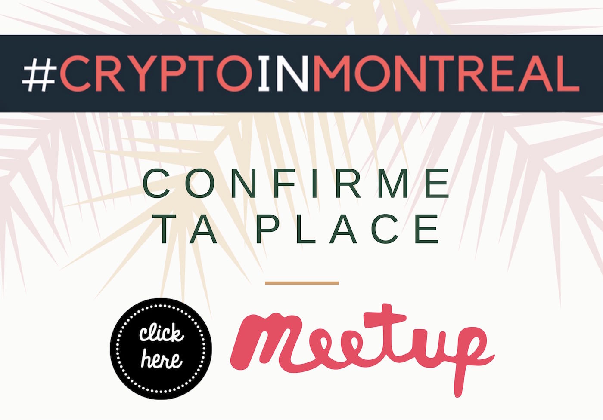

Pour le **20e événement** de #CryptoInMontreal, la présentation principale sera en anglais.

Les détails de cet événement se trouvent au:
[Lien permanent](/blog/cim-20/)

**Video**: available soon!

### ► INTRO

If you are already investing in crypto this question cannot be avoided. How will the Canada Revenue Agency (CRA) and Revenu Québec (RQ) tax your crypto investments?

Join us for a discussion of the current tax treatment of transactions involving cryptocurrencies. I will give the floor to **Laura Gheorghiu** for our main event. Laura is a Tax Partner at Gowling WLG, a legal leader in the Blockchain space.

The topics below will be discussed as well as any questions that you might have. Please note, not all questions currently have answers.

### ► CRÉDIT DE 20$

Tous les gens présents à l'événement obtiendront un crédit de 20$ valable sur un marché d'échange canadien. La carte 'voucher' sera remise en personne.

### ► AGENDA

1. Key income and sales tax rules when acquiring, trading or selling cryptocurrencies into fiat for investors and miners. I will explore those point:

- (i) the timing of taxation (at entry/exit into fiat or for every transaction)
- (ii) the treatment of crypto-currency exchanges and forks
- (iii) the availability of capital gains treatment

2. Income and sales tax rules that apply when a cryptocurrency is:

- (a) exchanged for goods and services
- (b) used to pay employees
- (c) lent

3. Taxation of ICOs for issuers and investors

## Quand et où ?

- **Quand**: Ce mardi 11 septembre dès 18h40
- **Lieu**: [Club Insiders](/blog/les-endroits-qui-acceillent-cryptoinmontreal/#club-insiders), 2067 Crescent St 2e étage, Montréal QC H3G 2C1 Montréal Quéebec Canada
- Le coût est de 10$ payable à l'entrée. Ce montant est chargé pour le Club Insiders qui est un espace de co-working et qui s'assure que toute la logistique de la soirée soit impeccable. En d'autres mots, aucun revenu ne va dans mes poches lol. **Le prix inclut**: les de cafés bio gourmands de torréfaction locale, les thés et tisanes, les pains hauts gamme, les biscuits, le caramel, les légumes et fruits secs. _Il y a même des produits sans gluten et véganes_ (c'est pas de l'inclusion ça!).

<iframe width="560" height="315" src="https://www.youtube.com/embed/2_rPjzXXfBA" frameborder="0" allow="autoplay; encrypted-media" allowfullscreen></iframe>

## Billetterie

Réservez votre place sur **Meetup** en [cliquant ici](https://www.meetup.com/CryptoInMontreal)

> Faire un RSVP, c'est s'engager à être présent à l'événement 🙌

Au plaisir de se croiser au prochain événement de #CryptoInMontreal!

Cheers!
Pascal

## Est-ce pour moi ?

L'événement #CryptoInMontreal s’adresse à toi si tu veux:

1. Commencer à investir dans les cryptomonnaies
2. Discuter avec des gens qui s’intéressent au blockchain et la crypto
3. Agrandir ton cercle d’amis et de connaissances

En d’autres mots, **#CryptoInMontreal** à trois buts principaux:

- Le **premier** objectif est de **démocratiser les cryptomonnaies** (cryptocurrency). Nous voulons aider les gens qui désirent commencer à investir dans les cryptomonnaies à faire leurs premiers pas.
- Le **deuxième** objectif est de **réunir les initiés** qui s'intéressent déjà au sujet des cryptomonnaies. Nous pourrons échanger et découvrir les différents enjeux de l’écosystème du blockchain et des cryptomonnaies altcoins.
- Le **troisième** objectif de #CryptoInMontreal est de **favoriser les triades**, c’est-à-dire créer un environnement propice à la création de nouvelles connexions entre des gens qui ne se connaissent pas. Ce concept m'a été inspiré de David Logan lors de son [TED talk](https://www.youtube.com/watch?v=xTkKSJSqU-I). Ceci est beaucoup plus puissant que de simplement réunir des gens dans une même salle.

- **Calendrier 2018**: /blog/calendrier-crypto-in-montreal/
- **Teaser** de l'événement sur [YouTube](https://www.youtube.com/watch?v=2_rPjzXXfBA)

## Un petit geste qui nous aide grandement

- Ça devient problématique quand les gens **confirment leurs présences mais ne se présentent pas** :•(
- Faire un **RSVP**, c'est s'engager à être présent à l'événement 🙌. Lorsque vous confirmez votre présence, merci de respecter votre engagement :•)

## Contacts

Je suis très actif sur [Twitter](https://twitter.com/askpascalandy) et sur le hashtag [#CryptoInMontreal](https://twitter.com/hashtag/CryptoInMontreal?src=hash)

Il y a plusieurs façons de demeurer au courant des prochains événements:

- [Site web officiel](/tags/crypto-in-montreal/)
- Captation live sur [YouTube](https://www.youtube.com/watch?v=8f-9rdxV6A0&list=PL9epbd8UeXHsfQe2Tr4O1T5FHdAafAk_b)
- Suivre sur [Meetup.com](https://www.meetup.com/CryptoInMontreal)
- Suivre sur [EventBrite](https://www.eventbrite.ca/o/cryptoinmontreal-15852655206)
- Suivre sur [Facebook](https://www.facebook.com/cryptoinmontreal/)
- Suivre sur [Twitter](https://twitter.com/search?src=typd&q=%23cryptoinmontreal)
