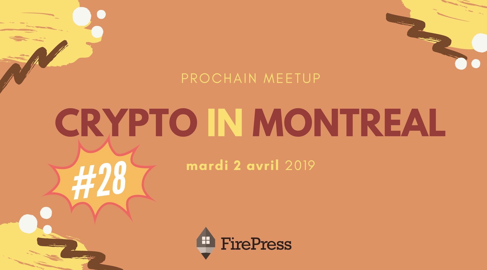

Join us for the 28th edition of Crypto In Montreal. Our hosts will be **Tamara Kara** and **Laura Gheorghiu**. We will dive deep into the privacy & confidentiality aspects of the blockchain. Then we will do Q&A session on crypto taxation and legal issues.

All details about [#CryptoInMontreal](/tags/crypto-in-montreal/) and tickets:

[https://pascalandy.com/blog/cim-28](/blog/cim-28/)

## Agenda

### 1) Privacy on the Blockchain

Should we be concerned about our financial privacy when using crypto? There is a popular misconception that transactions in Bitcoin network are private, anonymous, and untraceable. Yet it is not true. Transactions with bitcoins and most cryptocurrencies are pseudonymous and fully traceable.

This creates problems for individuals concerned about financial privacy and limits the utilization of the blockchain for businesses. But is fully confidential and private blockchain even possible and would it meet the basic KYC requirements? Tamara Kara, a certified blockchain and fintech professional will present the key aspects of privacy of blockchain transactions and discuss why it is important to understand the confidentiality issue.

### 2) Fiscality and Crypto Taxation

For the second part of the event we will host Laura Gheorghiu, Tax Partner at Gowling WLG for a Q&A on crypto taxation & legal issues. It’s the tax season and we all have questions about it.

- Is my Bitcoin taxed when I buy, sell or exchange it?
- What are the basic tax rules for miners and investors in Canada?
- Are ICOs taxed?

Crypto taxing and legal issues surrounding the blockchain can be confusing and complicated. Bring your questions and we will try to answer them!

Our Meetup is all about triads, genuine exchanges and learning. This is not your average class. It's also networking like networking should be done. See ya folks! 👩‍⚕️ 👨‍⚕️ 👩‍🌾 👨‍🌾 👩‍🍳 👨‍🍳 👩‍🎓 👨‍🎓 👩‍🎤 👨‍🎤

### Le quand, le où, le prix

|
---|---
**Où** : | Le [Club Insiders](/blog/les-endroits-qui-acceillent-cryptoinmontreal/#club-insiders) 2067 rue Crescent, Montréal Québec H3G 2C1 (2e étage)
**Quand** : | mardi le 2 avril 2019 à 18h00
**Prix** : | 10$

Merci d'arriver à **18h15 MAXIMUM**. On débutera pour 18h30 :)

### Billetterie

Réserve ta place sur **Meetup** en [cliquant ici](https://www.meetup.com/CryptoInMontreal)

### Teaser

<https://www.youtube.com/embed/2_rPjzXXfBA>

### 🙌 (TL;DR), en gros

- 🍺 de la boisson
- 🍕 de la bouffe (parfois oui, parfois non)
- 💡 du monde intéressé et intéressant
- ❤️ un sujet passionnant
- 🏒 un présentateur qui n'a pas peur d'aller dans les coins

### Official Sponsor

Because you need a website, because you [tried Ghost](https://firepress.org/#discover-ghost) and enjoyed the software, because our Early adopter’s [hosting plan](https://firepress.org/#pricing) is sound, because you believe [what we believe](https://firepress.org/en/why-launching-your-next-website-with-firepress/), and because it’s your turn to share with the world what you made...

At FirePress, we are honoured to launch your website and give it to you for a few days. After this period, you'll be free to leave no question asked or to continue your journey with us. <https://firepress.org/>

### Qu'est-ce que t'attends?

Amène tes fesses parce que c'est difficile de résister à ça si tu me demandes mon avis :-p

Cheers!

Pascal

P.S. C'est problématique quand les gens **confirment leurs présences mais ne se présentent pas**. Faire un **RSVP**, c'est s'engager à être présent à l'événement. Lorsque vous confirmez votre présence, merci de respecter votre engagement.
