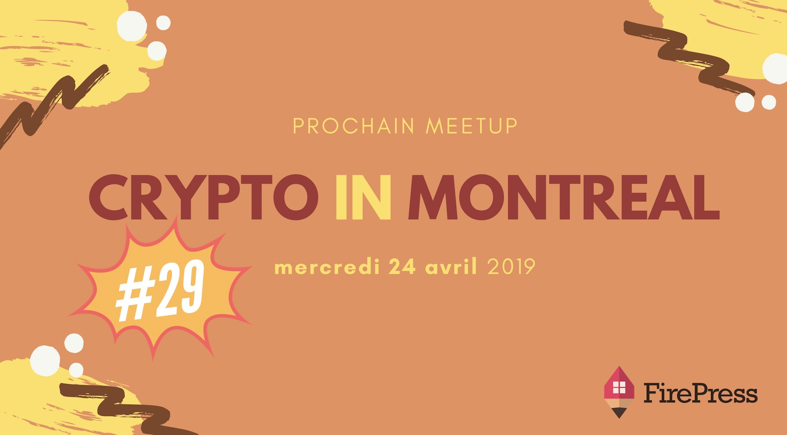

La **29e édition** de [Crypto In Montreal](/tags/crypto-in-montreal/) prendra le plancher du **Desjardins Lab** au centre-ville de Montréal.

**À boire** : Pour l'occasion, notre hôte nous offrira gracieusement la bière.
**À manger** : fruits, chips, et goodies. Arrivez tôt!

Les détails sur #CryptoInMontreal et la billetterie:

[Lire cet article](/blog/cim-29/)

Vous avez aussi l'option de commander en ligne (à vos frais) chez buddha-station.com/desjardinslab24. La livraison aura lieu à 16 h 30.

### À propos du Desjardins Lab

Le Desjardins Lab propose une programmation d'événements rassemblant des profils passionnés et inspirants, abordant des thématiques de l'innovation et du développement de la créativité. Leur objectif est de contribuer de manière engagée au développement de la culture d'innovation de notre société.

### L'ordre du jour

1. D'abord, pour ceux et celles qui désirent s'initier aux cryptomonnaies et au blockchain, **l'introduction au monde des cryptos** sera donnée par moi, Pascal Andy, dès 17h30. La présentation permettra d'introduire de façon très pratique ceux qui cherchent à faire leur premier pas dans le monde des cryptomonnaies.

2. **What the heck do miners mine?** Je ferai une démo unique en son genre qui démontre comment fonctionne le proof-of-work (PoW) qui sécurise le protocole Bitcoin.

3. Quelques nouvelles du monde des crypto

4. Q&A

Dans tous les cas, je vais m'assurer qu'on passe tous une belle soirée! Notre Meetup favorise les triades, les échanges authentiques et l'apprentissage. C'est pas ta classe boring. C'est du réseautage comme le réseautage devrait être fait. See ya 👩‍⚕️ 👨‍⚕️ 👩‍🌾 👨‍🌾 👩‍🍳 👨‍🍳 👩‍🎓 👨‍🎓 👩‍🎤 👨‍🎤.

### À propos du présentateur

[Lire cet article](/blog/qui-est-pascal-andy/)

### Le quand, le où, le prix

| @           | Details                                                    |
| ----------- | ---------------------------------------------------------- |
| **Où** :    | Desjardins Lab, 175 boul René-Lévesque O, Montréal H2X 3Y2 |
| **Quand** : | Mercredi 24 avril 2019 à 17h00                             |
| **Prix** :  | On s'en occupe, pour toi c'est gratuit.                    |

Merci d'arriver à **17h15 maximum**. On débutera pour 17h30 🙏.

### Billetterie

Réserve ta place parce que ça demande beaucoup d'organisation :

- sur **Meetup** en [cliquant ici](https://www.meetup.com/CryptoInMontreal) 👈
- sur **EventBrite** en [cliquant ici](https://www.eventbrite.ca/o/cryptoinmontreal-15852655206) 👈
  

### Teaser

<https://www.youtube.com/embed/2_rPjzXXfBA>

### 🙌 (TL;DR), en gros

- 🍺 de la boisson
- 🍕 de la bouffe (parfois oui, parfois non)
- 💡 du monde intéressé et intéressant
- ❤️ un sujet passionnant
- 🏒 un présentateur qui n'a pas peur d'aller dans les coins

### Sponsor officiel

Because you need a website, because you [tried Ghost](https://firepress.org/#discover-ghost) and enjoyed the software, because our Early adopter's [hosting plan](https://firepress.org/#pricing) is sound, because you believe [what we believe](https://firepress.org/en/why-launching-your-next-website-with-firepress/), and because it's your turn to share with the world what you made...

At **FirePress** , we are honoured to launch your website and give it to you for a few days. After this period, you'll be free to leave no question asked or to continue your journey with us. [Lire cet article](https://firepress.org/)

### Qu'est-ce que t'attends ?

Amène tes fesses parce que c'est difficile de résister à ça si tu me demandes mon avis 🙊. Il te reste juste à faire ton RSVP 🙌.

Cheers!

Pascal

_P.S. C'est problématique quand les gens **confirment leurs présences mais ne se présentent pas**. Faire un RSVP, **c'est s'engager** à être présent à l'événement 🙌. Merci de respecter votre engagement :-p_
