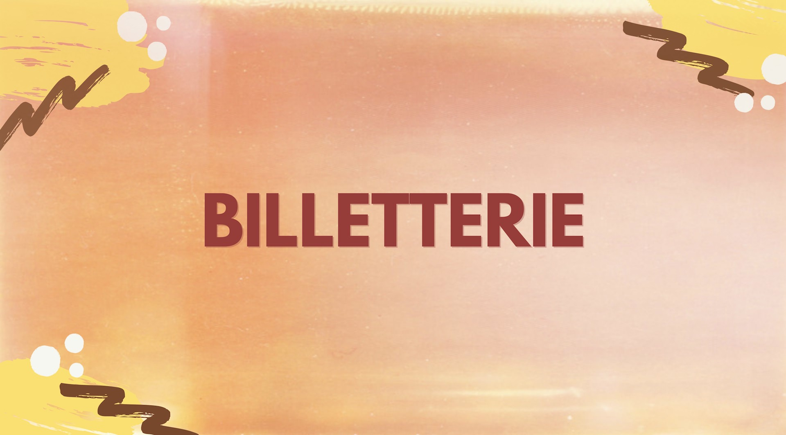
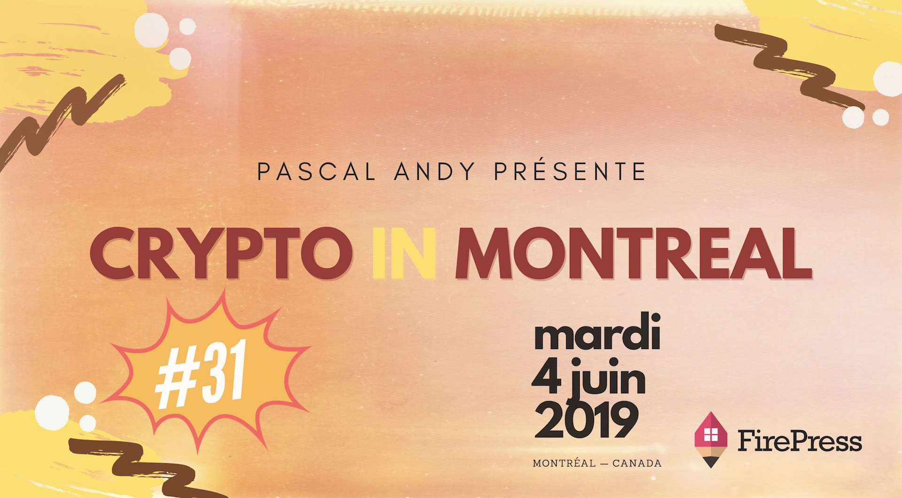

D3 et Fintech Cadence seront heureux de nous accueillir durant la **31e édition** de Crypto In Montreal.

Le thème de la soirée: Espérer le meilleur pour se préparer au pire.

Nous vivons dans un monde où toutes les fiat et cryptomonnaies doivent concurrencer et conquérir les utilisateurs. Cette nature concurrentielle dans la création de monnaie n’est pas différente de toute autre industrie, du vêtement à l’automobile." — [Ferdous Bhai](https://medium.com/chainrift-research/the-end-of-government-money-516aecf96754)

Vivre au jour le jour versus vivre une catastrophe naturelle, crise économique, crise sanitaire, une guerre.

**Tous les détails :**

- [pascalandy.com/blog/cim-31](/blog/cim-31/)
- [pascalandy.com/blog/crypto-in-montreal](/blog/crypto-in-montreal/) (notre site web)

### Qui est le présentateur ?

La présentation sera donnée par **Thierry Brégaint** , cofondateur de [Equibytes](http://www.equibytes.com/), dont le travail consiste à sensibiliser le public aux réseaux de guichets automatiques Bitcoin ici à Montréal.

### Mot de l'organisateur

Dans tous les cas, je vais m'assurer qu'on passe tous une belle soirée! Notre Meetup favorise les triades, les échanges authentiques et l’apprentissage. C'est pas ta classe boring. C'est du réseautage comme le réseautage devrait être fait. See ya 👩‍⚕️ 👨‍⚕️ 👩‍🌾 👨‍🌾 👩‍🍳 👨‍🍳 👩‍🎓 👨‍🎓 👩‍🎤 👨‍🎤.

[https://pascalandy.com/blog/qui-est-pascal-andy/](/blog/qui-est-pascal-andy/)

### Le quand, le où, le prix ?

| @           | Details                                              |
| ----------- | ---------------------------------------------------- |
| **Où** :    | Fintech Cadence, 1250 rue Guy #600, Montreal H3H 2L3 |
| **Quand** : | Mardi 4 juin 2019 à 17h15                            |
| **Prix** :  | gratuit!                                             |

Merci d'arriver à**17h30** **maximum**. On débutera pour 17h40 🙏.

### Billetterie

Réserve ta place ici. Ça demande beaucoup d'organisation :

- sur **Meetup** en [cliquant ici](https://www.meetup.com/CryptoInMontreal) 👈
- sur **EventBrite** en [cliquant ici](https://www.eventbrite.ca/o/cryptoinmontreal-15852655206) 👈

### Teaser 2019

<iframe width="560" height="315" src="https://www.youtube.com/embed/f3zyNnqi8gg" frameborder="0" allow="accelerometer; autoplay; encrypted-media; gyroscope; picture-in-picture" allowfullscreen></iframe>

### Teaser 2018

<iframe width="560" height="315" src="https://www.youtube.com/embed/2_rPjzXXfBA" frameborder="0" allow="autoplay; encrypted-media" allowfullscreen></iframe>

### Commanditaire officiel

Chez [FirePress](https://firepress.org/), nous nous efforçons de permettre aux entrepreneurs et aux petites organisations de créer leurs sites Web. Nous faisons l'**hébergement de votre site web** en plus d'aider nos clients à se familiariser avec la plate-forme Ghost.

Parce que nous croyons que[ votre site web doit parler en votre nom](https://firepress.org/en/why-launching-your-next-website-with-firepress/), nous considérons que notre mission est terminée une fois que votre site est devenu votre impresario.

### Qu'est-ce que t'attends ?

Amène tes fesses parce que c'est difficile de résister à ça si tu me demandes mon avis 🙊. Il te reste juste à faire ton RSVP 🙌.

### 🙌 (TL;DR), en gros

- 🍺 de la boisson
- 🍕 de la bouffe (parfois oui, parfois non)
- 💡 du monde intéressé et intéressant
- ❤️ un sujet passionnant
- 🏒 un présentateur qui n'a pas peur d'aller dans les coins

Cheers!

Pascal

_P.S. C'est problématique quand les gens **confirment leurs présences mais ne se présentent pas**. Faire un RSVP, **c'est s'engager** à être présent à l'événement. Merci de respecter votre engagement :-p_
