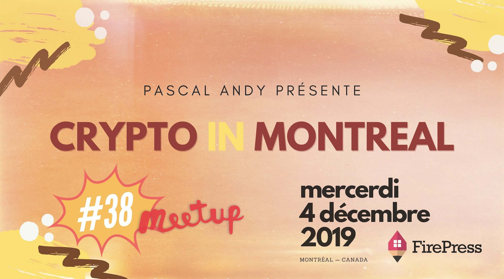

La **38e édition** de [Crypto In Montreal](/tags/crypto-in-montreal/) prendra le plancher du **Desjardins Lab** au centre-ville de Montréal.

Les détails sur #CryptoInMontreal et la billetterie:

[Lire cet article](https://pascalandy.com/blog/cim-38/)

### Le quand, le où, le prix

| Info      | Détails                                                    |
| --------- | ---------------------------------------------------------- |
| **Où**    | Desjardins Lab, 175 boul René-Lévesque O, Montréal H2X 3Y2 |
| **Quand** | mercredi 4 décembre 2019                                   |
| **Heure** | 17h30. Merci d'arriver au moins 10 minutes à l'avance.     |
| **Prix**  | On s'en occupe, pour toi c'est gratuit.                    |

### Les sujets

1. D'abord, pour ceux et celles qui désirent s'initier aux cryptomonnaies et au blockchain, **l'introduction au monde des cryptos** sera donnée par moi, Pascal Andy, dès 17h30. La présentation permettra d'introduire de façon très pratique ceux qui cherchent à faire leur premier pas dans le monde des cryptomonnaies.

2. **What the heck do miners mine?** Je ferai une démo unique en son genre qui démontre comment fonctionne le proof-of-work (PoW) qui sécurise le protocole Bitcoin.

3. Quelques **nouvelles** du monde des crypto

4. **Q &A**

Dans tous les cas, je vais m'assurer qu'on passe tous une belle soirée! Notre Meetup favorise les triades, les échanges authentiques et l’apprentissage. C'est pas ta classe boring. C'est du réseautage comme le réseautage devrait être fait. See ya 👩‍⚕️ 👨‍⚕️ 👩‍🌾 👨‍🌾 👩‍🍳 👨‍🍳 👩‍🎓 👨‍🎓 👩‍🎤 👨‍🎤.

**Un gros merci à FirePress** : Cet événement est possible grâce à l'appuie de [FirePress.org](https://firepress.org/). FirePress permet aux entrepreneurs et aux petites organisations de créer leurs sites Web. Ils font l'**hébergement de sites web** en plus d'aider leurs clients à se familiariser avec la plate-forme [Ghost](https://play-with-ghost.com/).

### À propos de l'organisateur

[Lire cet article](https://pascalandy.com/blog/qui-est-pascal-andy/)

### À propos du Desjardins Lab

Le Desjardins Lab propose une programmation d’événements rassemblant des profils passionnés et inspirants, abordant des thématiques de l’innovation et du développement de la créativité. Leur objectif est de contribuer de manière engagée au développement de la culture d’innovation de notre société.

### Billetterie

Réserve ta place parce que ça demande beaucoup d'organisation :

- sur **Meetup** en [cliquant ici](https://www.meetup.com/CryptoInMontreal) 👈
- sur **EventBrite** en [cliquant ici](https://www.eventbrite.ca/o/cryptoinmontreal-15852655206) 👈

### Teaser

### 🙌 (TL;DR), en gros

- 🍺 de la boisson
- 🍕 de la bouffe (parfois oui, parfois non)
- 💡 du monde intéressé et intéressant
- ❤️ un sujet passionnant
- 🏒 un présentateur qui n'a pas peur d'aller dans les coins

### Qu'est-ce que t'attends ?

Amène tes fesses parce que c'est difficile de résister à ça si tu me demandes mon avis 🙊. Il te reste juste à faire ton RSVP 🙌.

Cheers!

Pascal

_P.S. C'est problématique quand les gens **confirment leurs présences mais ne se présentent pas**. Faire un RSVP, **c'est s'engager** à être présent à l'événement 🙌. Merci de respecter votre engagement :-p_
