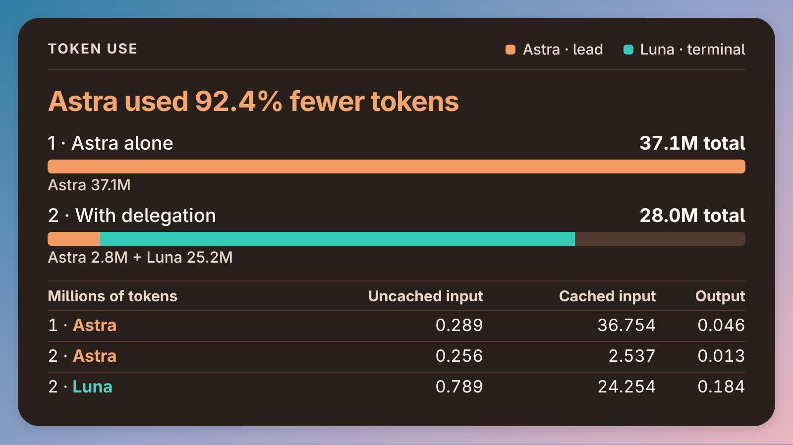

**My lead agent used 92.4% fewer tokens on a codebase audit.** I started two independent Codex sessions in T3 Code. Both got the same task: audit Mixtape, my desktop app for keeping Spotify playlists on disk.

| Scenario      | Lead model and reasoning effort | Terminal model and reasoning effort    |
| ------------- | ------------------------------- | -------------------------------------- |
| 1 · Direct    | GPT-6.2 Astra · **high**        | Astra ran its own tools                |
| 2 · Delegated | GPT-6.2 Astra · **high**        | One persistent GPT-6 Luna · **medium** |

Here’s the shared prompt.

> mixtape ;
>
> First read ALL of the AGENTS.md file and README.md file super carefully and understand ALL of both! Then use your code investigation agent mode to fully understand the code and technical architecture and purpose of the project. THEN apply `$reality-check-for-project` here in an exhaustive way.

**1 · Astra alone.** Astra read the code, ran the tests, and wrote the report.

**2 · Astra with Luna.** I added one instruction block. Astra chose the operations, grouped independent calls, and interpreted Luna’s results. [Jump to the reusable prompt](#copy-the-tool-call-delegation-prompt).

<details>
<summary>Exact instructions added in scenario 2</summary>

Use one Luna agent at medium reasoning effort as your terminal for the entire task.
Make direct tool calls only to start Luna or communicate with Luna.

1. At each step, identify all the tool calls you can specify.
2. For each call, tell Luna which operation to run and which result to return.
3. For AGENTS.md and README.md, request the complete contents of each file.
4. When calls can safely run in parallel, send them to Luna together for parallel execution.
5. Ask Luna to label each result and report any error or incomplete output.
6. Read both files in full.
7. When a call depends on an earlier result, inspect that result before you specify the call.
8. If Luna is unavailable or cannot run a required call, report the limitation.

Interpret the results yourself. Write the final answer yourself.

</details>

Follow the orange. Astra went from 37.1M tokens to 2.8M. Including Luna, the audit used 28.0M, down 24.4%. These are cumulative input and output tokens across requests. Cached history counts each time a model reads it.



<details>
<summary>Token counts by agent (millions)</summary>

| Scenario and agent | Uncached input | Cached input | Output |
| ------------------ | -------------: | -----------: | -----: |
| 1 · Astra          |          0.289 |       36.754 |  0.046 |
| 2 · Astra          |          0.256 |        2.537 |  0.013 |
| 2 · Luna           |          0.789 |       24.254 |  0.184 |

</details>

Astra sent Luna six work messages. The **162 tool calls** count 31 coordination calls from Astra and 131 calls from Luna. One call could batch several commands.


<details>
<summary>Tool calls by agent and operation</summary>

| Scenario and agent | Exec | Wait or sleep | Start agent | Total |
| ------------------ | ---: | ------------: | ----------: | ----: |
| 1 · Astra          |  160 |             3 |           0 |   163 |
| 2 · Astra          |   26 |             4 |           1 |    31 |
| 2 · Luna           |  129 |             2 |           0 |   131 |

</details>

## What was that worth in dollars and minutes?

A test log can reappear in the model’s input on every later request. Even at the cache discount, Astra alone spent an estimated **$32.28 rereading context**. With Luna, Astra’s cache reads cost **$2.03**. Its uncached input fell only 11.5%. The pair used more uncached input and generated more output, yet Luna’s entire share came to **58 cents**.


<details>
<summary>Estimated API cost by agent (USD)</summary>

| Scenario and agent | Uncached input | Cached input | Output |  Total |
| ------------------ | -------------: | -----------: | -----: | -----: |
| 1 · Astra          |          $4.79 |       $32.28 |  $3.84 | $40.91 |
| 2 · Astra          |          $4.09 |        $2.03 |  $1.02 |  $7.14 |
| 2 · Luna           |          $0.10 |        $0.35 |  $0.12 |  $0.58 |

Amounts are rounded independently.

</details>


I used `t3cli` to identify the runs and ClickHouse to price the Codex usage records per request. These are API-equivalent estimates at November 23, 2026 rates. Both Astra sessions requested `priority` (API Fast). Luna had no explicit service tier, so I priced it at Standard. Thirteen solo Astra requests and 34 Luna requests exceeded the 272,000-input-token threshold for long-context pricing. Delegated Astra stayed below it. At all-Standard rates, the same usage costs **$20.45 versus $4.15**. All figures are USD. [OpenAI API pricing](https://developers.openai.com/api/docs/pricing) · [Fast pricing](https://openai.com/api-fast-mode/)

## Two reports landed on my desk

Both runs downloaded 15 playable songs and passed 511 Rust and 192 Python tests. Yet my installed Linux app couldn’t find Deno. Astra alone reproduced the failure and got the engine check to pass by adding Deno to the audit process’s path.

The delegated run reproduced a Python 3.13 diagnostic failure. It also found that an interrupted replacement could leave a music player reading a stale playlist after the audio and index recovered. I ran each method once. The sessions started six seconds apart and tested the same baseline (`aea8e09`). The second inspected a later commit too. The timings measure each lead’s start to its final report, including tests and waits. This trial doesn’t isolate the time spent on delegation or establish equal audit quality.

## Was tool call delegation worth it?

**For the way I work in T3 Code? Absolutely.** I can leave an audit running in one thread and get on with something else. Whether I get the report after 45 minutes or 79 makes little difference to my day.

On this run, delegation added **33 minutes and 51 seconds** and saved an estimated **$33.20** at API rates. If the report blocked my next task, the extra spend would break even at about $59 per hour of my time. For a background audit, I’d give Luna the terminal again.

I’d also give it the working directory. Luna ran `just e2e` from the wrong directory and had to retry. Elsewhere, when a shallow Git repository refused a fetch, Luna found a way to reuse the existing objects. Luna recorded 107,095 reasoning tokens, already included in its output. I’d keep medium for that recovery work. I haven’t compared Luna at low, medium, and high on the same task.

## Copy the tool call delegation prompt

After the audit, I tightened the instructions to cover working directories and fallbacks. This is the version I’d append to my next task. The measurements above come from the original instructions. Your agent needs to be able to start a second agent and send it follow-up messages.

```text
Use one persistent GPT-6 Luna agent at medium reasoning effort.
Delegate all task-related tool calls to Luna. Make direct calls only
to start Luna or communicate with it. You choose the operations,
interpret the results, and write the final answer.

Send an ID, the exact tool and arguments, and the output you need.
For shell commands, include the absolute working directory.
Batch independent calls when safe. Read each prerequisite result
before choosing a dependent call.

Give Luna these rules at startup:
- Execute the specified calls. Run marked parallel calls together.
- Follow running commands to completion. Return the ID, status,
  and requested output. Quote errors exactly. Flag truncated output.
- Use a fallback only if I specify the trigger and the exact action.
- When you need a decision, ask me. Continue independent calls.
```

I keep the full instructions in my `tool-call-delegation` skill. The skill requires Fleet, `uv`, and a configured delegation profile. With those in place, I can append `$tool-call-delegation` to a task and specify Luna at medium effort to use the same setup.

<https://github.com/pascalandy/skills/tree/main/authoring/andy/tool-call-delegation>
