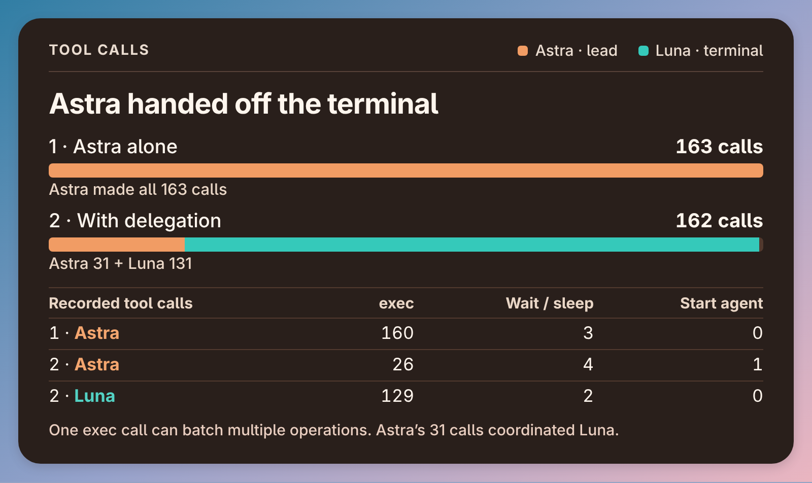
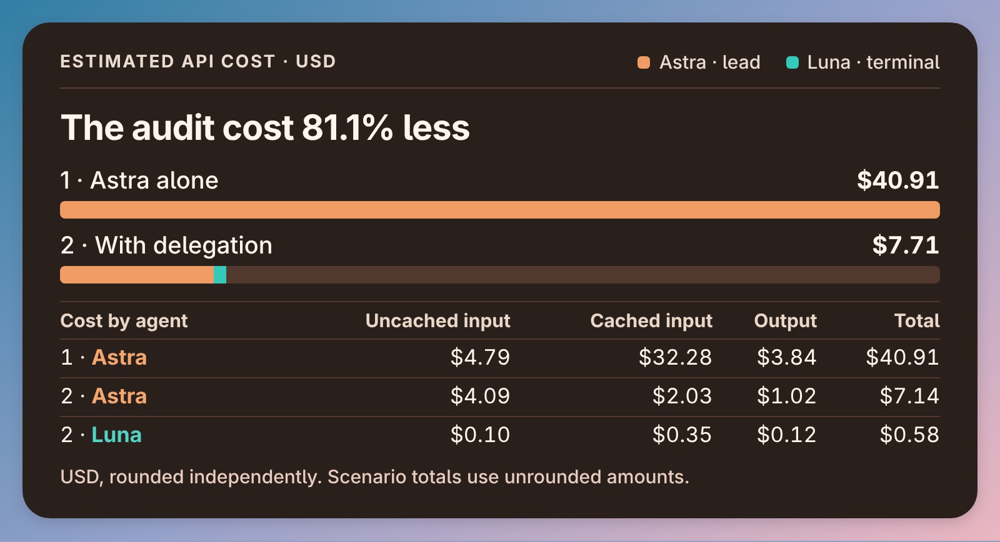
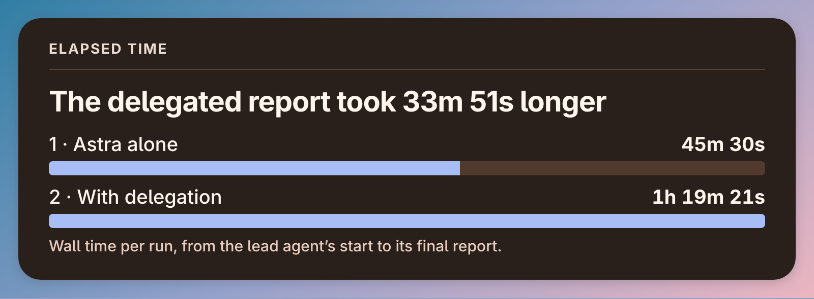

**My lead agent used 92.4% fewer tokens on a codebase audit.** I gave two GPT-6.2 Astra agents the same prompt about Mixtape, my desktop app for keeping Spotify playlists on disk. Both ran at high reasoning effort.

> mixtape ;
>
> First read ALL of the AGENTS.md file and README.md file super carefully and understand ALL of both! Then use your code investigation agent mode to fully understand the code and technical architecture and purpose of the project. THEN apply `$reality-check-for-project` here in an exhaustive way.

**1 · Astra alone.** Astra read the code, ran the tests, and wrote the report.

**2 · Astra with Luna.** I added one instruction block. Astra sent every task-related tool call to one persistent GPT-6 Luna agent at medium effort. Astra could batch independent calls and kept the final say.

Follow the orange. Astra went from 37.1M tokens to 2.8M. Including Luna, the audit used 28.0M, down 24.4%.

The call count barely moved. What changed was whose conversation filled up with code and test logs.

## What was that worth in dollars and minutes?

A test log can reappear in the model’s input on every later request. Even at the cache discount, Astra alone spent an estimated **$32.28 rereading context**. With Luna, Astra’s cache reads cost **$2.03**. Its uncached input fell only 11.5%. The pair used more uncached input and generated more output, yet Luna’s entire share came to **58 cents**.

I matched the three T3 sessions and priced each request in ClickHouse at November 23, 2026 API rates, outside my Codex plan. I used Astra’s configured Fast tier, assumed Standard for Luna, and included long-context pricing above 272,000 input tokens. At all-Standard rates, the same usage costs **$20.45 versus $4.15**. All figures are USD. [OpenAI API pricing](https://developers.openai.com/api/docs/pricing) · [Fast pricing](https://openai.com/api-fast-mode/)

## Two reports landed on my desk

Both runs downloaded 15 playable songs and passed 511 Rust and 192 Python tests. Yet my installed Linux app couldn’t find Deno. Astra alone reproduced the failure and got the engine check to pass by adding Deno to the audit process’s path.

The delegated run reproduced a Python 3.13 diagnostic failure. It also found that an interrupted replacement could leave a music player reading a stale playlist after the audio and index recovered. Each method ran once from the same starting revision. The second inspected a later commit too. I’d use this trial to budget another audit, not to rank bug-finding ability.

## How I’d run it again

Luna ran `just e2e` in the wrong directory and had to retry. Giving it an absolute path would have saved a round trip. When a shallow Git repository refused a fetch, Luna found a way to reuse the existing objects. I’d keep medium effort for that recovery. I haven’t tested low.

My `tool-call-delegation` skill keeps the decisions with Astra. Asking Luna to “find contradictions” delegates judgment. Asking for lines 40–85 of a file delegates a read. If your setup supports a persistent agent and follow-up messages, paste the instructions after your task or invoke `$tool-call-delegation` once installed. [Get the instructions](https://github.com/pascalandy/skills/tree/main/authoring/andy/tool-call-delegation)

Would I pay **$33.20** to get those **33 minutes and 51 seconds** back? If the result blocks work worth more than **$59 an hour**, yes. If I’m heading out for lunch, Luna gets the terminal.
